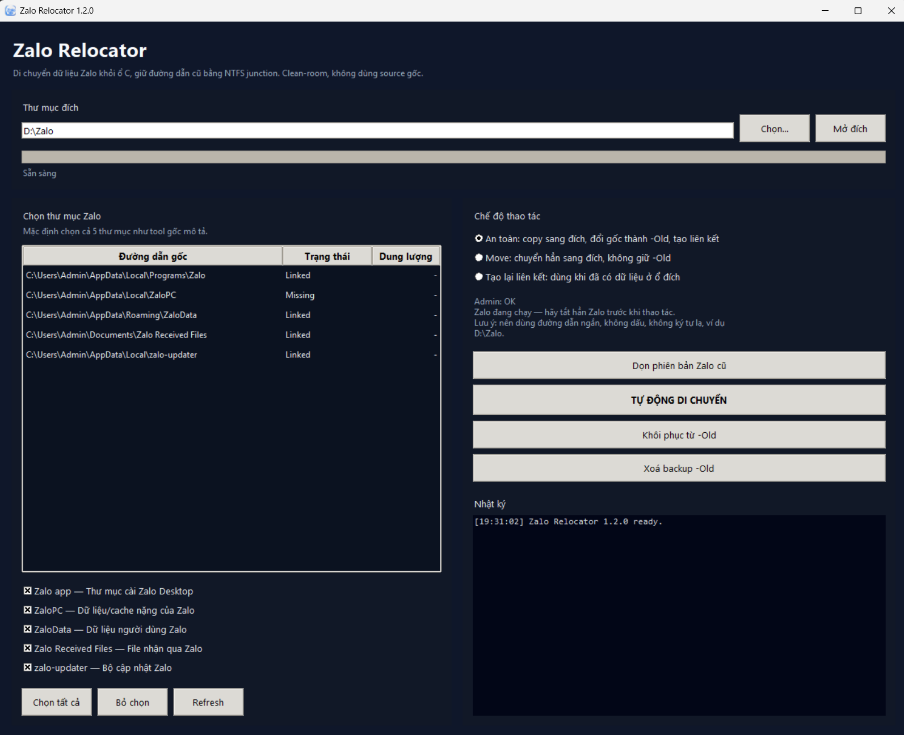

# Zalo Relocator — Zalo Mover for Windows (v1.3.2)

Ứng dụng Windows giúp **di chuyển dữ liệu Zalo Desktop** khỏi ổ C sang ổ đĩa khác, hoặc chuyển tiếp giữa các ổ đĩa (ví dụ từ ổ D sang ổ F khi nâng cấp/thay ổ cứng), sau đó tự động tạo hoặc cập nhật NTFS junction để Zalo tiếp tục sử dụng đường dẫn cũ như bình thường.

**English:** A lightweight, reliable Zalo data relocator for Windows. Move Zalo Desktop data from C: or between multiple secondary drives (e.g., D: to F: when upgrading drives), preserve original paths with NTFS junctions, manage & selectively delete backups, and clean old Zalo versions. An independent clean-room alternative for ZaloMove-style workflows.

> Zalo Relocator là dự án clean-room độc lập, không chứa hoặc sử dụng mã nguồn của Zalo hay ZaloMove.



---

## Tính năng nổi bật

- **Giao diện hiện đại, tối ưu 3 chế độ chuyên biệt:**
  - **1. Di chuyển sang ổ mới (Move / Đổi ổ cứng):** Hỗ trợ chuyển từ ổ C sang ổ khác hoặc chuyển tiếp giữa 2 ổ phụ (như D: sang F:).
  - **2. Chỉ tạo lại liên kết (Relink):** Giao diện tinh gọn, chỉ hiển thị nút tạo liên kết — dùng khi vừa cài lại Windows hoặc dữ liệu đã có sẵn trên ổ phụ.
  - **3. Khôi phục & Dọn dẹp:** Khôi phục dữ liệu về ổ C, chọn lọc xoá bản backup `-Old`, và dọn dẹp các phiên bản Zalo cũ.
- **Tự động gom gọn vào thư mục con `Zalo` tại đích:**
  - Tự động gói toàn bộ các thư mục (`Zalo`, `ZaloData`, `zalo-updater`...) vào một thư mục cha `Zalo` tại ổ đích thay vì rải rác ở thư mục gốc của ổ đĩa.
  - Có dòng **Xem trước đường dẫn thực tế** theo thời gian thực.
  - Xử lý thông minh, không bao giờ tạo thư mục trùng lặp như `Zalo\Zalo`.
- **Cửa sổ Quản lý & Chọn lọc xoá Backup (`BackupManagerDialog`):**
  - Tự động quét tìm tất cả các thư mục sao lưu `-Old` trên mọi ổ đĩa trong máy (`C:`, `D:`, `E:`, `F:`...).
  - Cung cấp giao diện bảng tích chọn: Hiển thị chi tiết tên thư mục, dung lượng, ngày sửa đổi và đường dẫn đầy đủ.
  - Người dùng có thể **chủ động tích chọn bản nào muốn xoá, bản nào muốn giữ lại** (các bản bỏ tích được bảo vệ an toàn 100%).
  - Hỗ trợ nút *Chọn tất cả*, *Bỏ chọn tất cả* và tính năng *📁 Quét thêm thư mục khác...* để quét thêm các ổ cứng ngoài hoặc thư mục lưu trữ riêng.
- **Chống lỗi đệ quy lặp vô tận:**
  - Tự động xử lý an toàn khi thư mục đích nằm bên trong thư mục nguồn (ví dụ di chuyển từ `F:\Zalo` vào `F:\Zalo\Zalo`).
  - Prune đường dẫn đích trong luồng quét `copytree_merge`, ngăn chặn hoàn toàn lỗi `maximum recursion depth exceeded`.
- **Tự nhận diện các thư mục Zalo chuẩn:**
  - `%LocalAppData%\Programs\Zalo` (Bộ cài ứng dụng)
  - `%LocalAppData%\ZaloPC` (Dữ liệu/cache của một số bản cũ)
  - `%AppData%\ZaloData` (Dữ liệu người dùng, tin nhắn)
  - `%USERPROFILE%\Documents\Zalo Received Files` (File nhận qua Zalo)
  - `%LocalAppData%\zalo-updater` (Bộ cập nhật Zalo)
- **Nhận diện tiến trình Zalo chuẩn xác:**
  - Dùng Win32 Toolhelp Snapshot API, loại trừ PID của công cụ, không bao giờ nhận diện nhầm chính mình.
  - Có nút **Đóng Zalo** trực tiếp trên giao diện để tắt Zalo nhanh chóng trước khi thao tác.
- **Sao chép an toàn & hiệu năng cao:**
  - Copy đa luồng với tối đa 8 I/O worker, phù hợp với lượng dữ liệu hàng chục GB.
  - Thanh tiến trình hiển thị phần trăm, dung lượng, tốc độ (MB/s) và ước tính thời gian còn lại (ETA).
- **Tự động xử lý phân quyền Windows:**
  - Tự gỡ cờ Read-Only trên các file SQLite/cache khi xoá backup để không gặp lỗi phân quyền.

---

## Yêu cầu hệ thống

- Windows 10 hoặc Windows 11, 64-bit.
- Chạy bằng quyền **Run as administrator** để tạo và cập nhật NTFS junction ổn định.
- Ổ đĩa đích định dạng NTFS.
- Khuyến nghị đóng Zalo trước khi thao tác (hoặc dùng nút **Đóng Zalo** có sẵn trong tool).

---

## Hướng dẫn sử dụng

### 1. Di chuyển sang ổ mới (Lần đầu hoặc khi thay ổ cứng)
1. Tải file chạy `zalorelocator.v1.3.2.exe` (hoặc `ZaloRelocator.exe`) từ mục Releases.
2. Nhấp chuột phải vào file và chọn **Run as administrator**.
3. Tại ô **Thư mục đích**, chọn ổ đĩa hoặc thư mục bạn muốn lưu (ví dụ `D:\Zalo` hoặc `F:\`).
   - Giữ tích chọn **Tự động gom trọn các thư mục vào thư mục con 'Zalo' tại đích**.
4. Chọn chế độ **Di chuyển sang ổ mới (Move / Đổi ổ cứng)**:
   - *Sao chép an toàn (khuyên dùng):* Giữ bản sao lưu `-Old` tại ổ cũ để kiểm tra.
   - *Tạo / Cập nhật liên kết (junction):* Mặc định bật để Zalo hoạt động ngay.
5. Nhấn **BẮT ĐẦU DI CHUYỂN**.
6. Sau khi hoàn tất, Zalo sẽ tự động mở lên. Bạn kiểm tra tin nhắn, đăng nhập và gửi file.
7. Khi Zalo hoạt động bình thường, bạn có thể mở bảng quản lý backup để chọn xoá các bản `-Old` nhằm giải phóng ổ đĩa.

### 2. Chỉ tạo lại liên kết (Relink)
Dùng khi bạn **vừa cài lại Windows** hoặc **dữ liệu Zalo đã có sẵn trên ổ phụ**:
1. Chọn chế độ **Chỉ tạo lại liên kết (Relink)**.
2. Chọn đúng thư mục chứa Zalo trên ổ phụ (ví dụ `D:\Zalo`).
3. Bấm **TẠO LẠI LIÊN KẾT (RELINK)**. Tool sẽ tạo lại toàn bộ junction ở ổ C: trỏ tới ổ phụ trong 1 giây mà không cần copy lại dữ liệu.

### 3. Khôi phục & Dọn dẹp
1. Chọn chế độ **Khôi phục & Dọn dẹp**.
2. Tuỳ chọn các thao tác:
   - **Khôi phục dữ liệu về ổ C:** Chép ngược dữ liệu từ ổ phụ về lại ổ C mặc định.
   - **Xoá các thư mục backup -Old:** Mở bảng quản lý để chọn lọc xoá các bản backup `-Old` trên máy.
   - **Dọn phiên bản Zalo cũ:** Quét và xoá các thư mục cài đặt phiên bản cũ dạng `Zalo-x.y.z`, luôn giữ lại phiên bản mới nhất.

---

## Chạy từ mã nguồn & Tự Build

### Yêu cầu:
Python 3.9+ trên Windows.

```powershell
git clone https://github.com/kin203/ZaloMove-Relocator.git
cd ZaloMove-Relocator
python .\src\main.py
```

### Build file EXE:
Chạy script build tự động:

```powershell
.\build.ps1
```

Tệp thực thi độc lập sẽ được tạo tại `dist\zalorelocator.v1.3.2.exe` và `dist\ZaloRelocator.exe`.

---

## Cấu trúc thư mục

```text
ZaloRelocator/
├─ assets/
│  ├─ ZaloRelocator.ico
│  ├─ ZaloRelocator.png
│  └─ screenshot.png
├─ src/
│  └─ main.py
├─ build.ps1
├─ LICENSE
└─ README.md
```

---

## Lưu ý an toàn

- Luôn kiểm tra Zalo hoạt động đầy đủ (đăng nhập, tin nhắn, ảnh) trước khi xoá các bản sao lưu `-Old`.
- Không tắt máy hay ngắt nguồn khi quá trình sao chép đang diễn ra.
- Tốc độ sao chép phụ thuộc vào tốc độ ổ đĩa (HDD/SSD/NVMe) và phần mềm diệt virus trên máy bạn.

---

## Giấy phép (License)

Dự án được phát hành theo giấy phép [MIT License](LICENSE).

## Tuyên bố miễn trừ trách nhiệm (Disclaimer)

Zalo là sản phẩm và nhãn hiệu đã đăng ký của VNG Corporation. Dự án này là công cụ nguồn mở độc lập, không liên kết, không được tài trợ và không đại diện cho Zalo hoặc VNG. Người dùng tự chịu trách nhiệm sao lưu và kiểm tra dữ liệu của mình.
